<p align="center">
  
</p>

<p align="center">
  <a href="https://github.com/ishandutta2007/Awesome-Awesome-Awesome"></a><a href="https://discord.gg/jc4xtF58Ve"></a>
  <a href="https://github.com/ishandutta2007/Awesome-Internal-Opportunity-Marketplace/stargazers"></a>
  <a href="https://github.com/ishandutta2007/Awesome-Internal-Opportunity-Marketplace/network"></a>
  <a href="https://opensource.org/licenses/MIT"></a>
  <a href="http://makeapullrequest.com"></a>
  <a href="https://github.com/ishandutta2007"></a>
</p>

---

# 🚀 Awesome Internal Opportunity Marketplace (ITM)

> **A curated directory of SaaS platforms, enterprise tools, and open-source software engineered for internal talent mobility, AI skills-based matching, gig allocation, competency matrices, and career pathing.**

Welcome to the definitive ecosystem guide for **Internal Opportunity Marketplaces (IOM / ITM)**. An Internal Opportunity Marketplace connects enterprise employees with cross-functional gigs, stretch assignments, open internal requisitions, mentorship programs, and tailored learning paths. By shifting workforce planning from rigid departmental silos to dynamic, skills-first agility, these tools unlock latent productivity, slash external recruitment costs, and boost employee engagement and retention.

---

## 📑 Table of Contents

- [🌐 Sector Overview & Market Dynamics](#-sector-overview--market-dynamics)
- [🏢 SaaS & Enterprise Platforms](#-saas--enterprise-platforms)
- [💻 Open-Source Repositories & Frameworks](#-open-source-repositories--frameworks)
- [🧩 Foundational Tooling & AI Building Blocks](#-foundational-tooling--ai-building-blocks)
- [🏗️ Recommended Architectural Stack](#️-recommended-architectural-stack)
- [🤝 How to Contribute](#-how-to-contribute)
- [💖 Support & Sponsorship](#-support--sponsorship)
- [⭐ Star History](#-star-history)
- [⚖️ Disclaimer & Compliance](#️-disclaimer--compliance)

---

## 🌐 Sector Overview & Market Dynamics

The global **Internal Talent Marketplace and Workforce Agility Platform** market is valued at approximately **$2.1 billion to $4.6 billion** (depending on broader Human Capital Management suite overlap) and is projected to surpass **$7.0 billion to $10.1 billion by 2032–2034**, expanding at a compound annual growth rate (**CAGR**) of **14.2% to 16.8%**.

Market dynamics exhibit a **moderately fragmented yet rapidly consolidating, bifurcated landscape**:
- **Enterprise HCM Suite Consolidation:** Legacy enterprise titans (*Salesforce*, *Workday*, *ServiceNow*, *SAP SuccessFactors*) integrate native talent marketplace modules to provide seamless data continuity across payroll, core HR, and compliance.
- **Specialized AI Pure-Plays:** Agile innovators (*Gloat*, *Eightfold AI*, *Fuel50*, *Phenom*, *Beamery*) lead in deep skills ontologies, graph neural networks, and personalized employee career navigation. Rather than a pure "winner-take-all" outcome, the sector is characterized by strategic M&A (e.g., ServiceNow acquiring Hitch Works) and bi-directional API ecosystems pairing specialized intelligence layers with incumbent core HRIS platforms.

---

## 🏢 SaaS & Enterprise Platforms

The table below curates the premier enterprise Internal Opportunity Marketplace and Talent Mobility SaaS solutions. Products are sorted in **descending order by company size** (market capitalization or valuation / annual recurring revenue).

| 🏢 Product | 📈 Company Size (Valuation / Revenue) | 💵 Starting Pricing | 🎁 Free Tier / Trial Limit | 🎯 Key Focus & Mobility Features |
| :--- | :--- | :--- | :--- | :--- |
| **[Salesforce Opportunity Marketplace](https://www.salesforce.com/)** | **$280B+ Market Cap**<br>*(~$35.7B ARR)* | **$25 / user / month**<br>*(Starter Suite entry; Enterprise Talent packages start at ~$165/user/month)* | **30-Day Free Trial**<br>*(Full platform sandbox for up to 2 users with sample records & custom objects)* | Enterprise internal gig staffing, Trailhead skill validation, and ecosystem-wide career mobility connected to CRM and employee records. |
| **[Hitch Works (ServiceNow)](https://www.servicenow.com/)** | **$190B+ Market Cap**<br>*(ServiceNow parent; acquired Hitch for ~$40M; $10B+ ARR)* | **$20 / user / month**<br>*(Employee Center Pro add-on tier; enterprise annual minimums apply)* | **14-Day Guided Sandbox**<br>*(Restricted to qualified IT/HR enterprise evaluations with up to 10 admin seats)* | Dynamic skills mapping, project/gig matchmaking, and workflow orchestration built into ServiceNow Employee Workflows. |
| **[Workday Talent Marketplace](https://www.workday.com/)** | **$68B+ Market Cap**<br>*(~$7.3B ARR)* | **$99 / employee / month**<br>*(Baseline HCM subscription; Skills Cloud add-on ~$100–$180/employee/year)* | **30-Day Guided Sandbox**<br>*(Invite-only evaluation sandbox with synthetic employee data; no public self-serve tier)* | Deep machine learning matching across internal gigs, mentoring, and full-time internal roles powered by Workday Skills Cloud. |
| **[Cornerstone Galaxy](https://www.cornerstoneondemand.com/)** | **$5.2B Valuation**<br>*(Clearlake Capital; ~$900M ARR)* | **$6.00 / user / month**<br>*(Base learning/skills tier; full Galaxy Talent Suite starts at ~$15/user/month, $20k/yr floor)* | **14-Day Proof-of-Concept**<br>*(Limited to 25 benchmark employee profiles and pre-configured competency rubrics)* | Comprehensive workforce agility, AI-driven skills readiness agents, internal gig marketplaces, and personalized career roadmaps. |
| **[Eightfold AI](https://eightfold.ai/)** | **$2.1B Valuation**<br>*(Series E; ~$120M ARR)* | **$7.00 / employee / month**<br>*(Billed annually; mid-market base packages start at ~$84,000/year minimum)* | **14-Day Interactive Sandbox**<br>*(Limited to 5 HR administrator seats and 50 simulated employee talent profiles)* | Deep-learning talent intelligence engine featuring global skill taxonomies, bias mitigation, and predictive career pathing. |
| **[Degreed](https://degreed.com/)** | **$1.4B Valuation**<br>*(Series D; ~$130M ARR)* | **$10.00 / user / month**<br>*(Annual billing; team starter plans start at $1,200/year floor)* | **Free Forever (Individual)**<br>*(Free individual tier with 1 user profile and personal skill pathways; 30-day enterprise POC)* | Learning Experience Platform (LXP) combining skill verification, peer learning pathways, and internal project opportunity discovery. |
| **[Phenom Talent Marketplace](https://www.phenom.com/)** | **$1.4B Valuation**<br>*(Series D; ~$110M ARR)* | **$8.50 / employee / month**<br>*(Talent Experience suite starting floor averages ~$10,000/month for enterprise)* | **14-Day Enterprise Trial**<br>*(Configured for up to 10 talent admins and 100 sample candidate/employee records)* | AI-powered talent experience management encompassing employee gig matching, career pathing, alumni networks, and mentoring. |
| **[Beamery](https://beamery.com/)** | **$1.0B Valuation**<br>*(Series D Unicorn; ~$65M ARR)* | **$12.50 / employee / month**<br>*(Modular talent mobility tier; full platform contracts start at ~$220,000/year)* | **14-Day Private Sandbox**<br>*(Restricted to 5 administrator accounts and up to 250 internal candidate profiles)* | Talent lifecycle intelligence platform unifying skills telemetry, workforce planning, succession planning, and internal mobility. |
| **[Gloat](https://gloat.com/)** | **$550M Valuation**<br>*(Series D; ~$45M ARR)* | **$6.50 / employee / month**<br>*(Foundational internal mobility tier; full agility suite averages ~$8.00–$10.00 PEPM)* | **30-Day Pilot Sandbox**<br>*(Enterprise POC sandbox deployment limited to 50 active internal testers; no free plan)* | Pioneer of AI talent marketplace technology; matches employees to real-time gigs, stretch projects, mentoring, and full roles. |
| **[Fuel50](https://fuel50.com/)** | **$120M Valuation**<br>*(Series B/C; ~$20M ARR)* | **$4.50 / employee / month**<br>*(Core career architecture tier; full mobility platform starts at ~$7.50 PEPM, $15k/yr floor)* | **14-Day Evaluation Trial**<br>*(Capped at 20 user seats, benchmark skills matrix, and 3 career progression frameworks)* | Career pathing architecture, I/O psychology-aligned competency mapping, talent benchmarking, and internal gig allocation. |

---

## 💻 Open-Source Repositories & Frameworks

Open-source tooling provides self-hosted, data-sovereign, and customizable solutions for engineering teams building bespoke internal talent marketplaces, skills matrices, and opportunity matching engines.

Repositories are listed in **descending order by GitHub star count**.

- **[frappe/hrms](https://github.com/frappe/hrms)** [](https://github.com/frappe/hrms/stargazers)  
  *Open-source HR and payroll platform featuring recruitment, employee skill assessments, internal job postings, performance appraisals, and full employee lifecycle tracking.* Built on Python/Frappe framework. (GPL-3.0)

- **[algora-io/algora](https://github.com/algora-io/algora)** [](https://github.com/algora-io/algora/stargazers)  
  *Open-source bounty and developer opportunity marketplace connecting organizations with engineering talent via GitHub issues, automated payouts, and skill verification.* (AGPL-3.0)

- **[BohdanOrlov/ios-skills-matrix](https://github.com/BohdanOrlov/ios-skills-matrix)** [](https://github.com/BohdanOrlov/ios-skills-matrix/stargazers)  
  *Comprehensive engineering competency and skills matrix framework for structuring career ladders, performance reviews, and technical capability benchmarking.* (MIT)

- **[Semalab/developer-skills-matrix](https://github.com/Semalab/developer-skills-matrix)** [](https://github.com/Semalab/developer-skills-matrix/stargazers)  
  *Developer skills evaluation rubric and competency matrix for engineering career progression, mentorship pairing, and internal capability discovery.* (MIT)

- **[hltbra/programmer-competency-checklist](https://github.com/hltbra/programmer-competency-checklist)** [](https://github.com/hltbra/programmer-competency-checklist/stargazers)  
  *Interactive checklist and matrix for benchmarking technical competencies, engineering career growth, and skill gap analysis across software development disciplines.* (MIT)

- **[angelabassa/data-science-competency-matrix](https://github.com/angelabassa/data-science-competency-matrix)** [](https://github.com/angelabassa/data-science-competency-matrix/stargazers)  
  *Structured competency matrix and rubric for data science and analytics professionals, mapping seniority tiers and skill expectations.* (CC-BY-4.0)

- **[HRPulsar/hrpulsar](https://github.com/HRPulsar/hrpulsar)** [](https://github.com/HRPulsar/hrpulsar/stargazers)  
  *Competency-first open-source talent management platform featuring competency graphs, internal talent marketplace, 360-degree feedback, development plans, and AI workforce tracking.* Built with FastAPI and Next.js. (AGPL-3.0)

- **[workcontrolgit/TalentManagement](https://github.com/workcontrolgit/TalentManagement)** [](https://github.com/workcontrolgit/TalentManagement/stargazers)  
  *Clean architecture enterprise talent management REST API solution built with .NET and Entity Framework for tracking employee capabilities, positions, and promotions.* (MIT)

- **[AounYoussef/JobCrafting](https://github.com/AounYoussef/JobCrafting)** [](https://github.com/AounYoussef/JobCrafting/stargazers)  
  *AI-powered job crafting and career matchmaking tool designed to align employee skills, personal aspirations, and organizational opportunities.* (MIT)

- **[francescopace/peoplemesh](https://github.com/francescopace/peoplemesh)** [](https://github.com/francescopace/peoplemesh/stargazers)  
  *AI matching layer for modern organizations, featured in Red Hat AI Quickstarts. Connects employees with internal projects, gigs, and communities using graph-like embedding vectors and GDPR-compliant audit logs.* (Apache-2.0)

- **[paulcutting/skills-matrix](https://github.com/paulcutting/skills-matrix)** [](https://github.com/paulcutting/skills-matrix/stargazers)  
  *React application for visualizing, tracking, and managing team skill levels, talent distribution, and internal growth opportunities.* (MIT)

- **[magantoine/JobSkape](https://github.com/magantoine/JobSkape)** [](https://github.com/magantoine/JobSkape/stargazers)  
  *Framework for generating synthetic job postings and benchmarking NLP-based skill matching models for talent discovery systems.* (MIT)

- **[ArjunFrancis/OpenHR](https://github.com/ArjunFrancis/OpenHR)** [](https://github.com/ArjunFrancis/OpenHR/stargazers)  
  *Lightweight open-source HR and talent matching platform featuring skill-tag-based match algorithms for founders, technical teams, and internal placements.* (MIT)

- **[upes-open/OSoC-25-Giglance](https://github.com/upes-open/OSoC-25-Giglance)** [](https://github.com/upes-open/OSoC-25-Giglance/stargazers)  
  *Open-source gig work and freelance opportunity platform with intelligent candidate recommendations and project management workflows.* (MIT)

- **[ArjunFrancis/openhr-founder-ai](https://github.com/ArjunFrancis/openhr-founder-ai)** [](https://github.com/ArjunFrancis/openhr-founder-ai/stargazers)  
  *AI-driven talent matching engine utilizing Sentence Transformers, spaCy Named Entity Recognition (NER), Supabase PostgreSQL, and LangGraph multi-agent workflows.* (MIT)

- **[harshspotted/JTP_PROJECT](https://github.com/harshspotted/JTP_PROJECT)** [](https://github.com/harshspotted/JTP_PROJECT/stargazers)  
  *AI-powered employee skill and project recommendation system using Qdrant vector database embeddings and local Ollama LLMs for semantic role matching.* (MIT)

- **[harsh09jt/skillsync](https://github.com/harsh09jt/skillsync)** [](https://github.com/harsh09jt/skillsync/stargazers)  
  *Workforce skill intelligence platform utilizing multi-agent AI architecture, Spring Boot, MySQL, and Gemini AI for automated skill gap analysis and personalized learning path generation.* (MIT)

- **[hasanbaroki/agentic-ai-career-intelligence](https://github.com/hasanbaroki/agentic-ai-career-intelligence)** [](https://github.com/hasanbaroki/agentic-ai-career-intelligence/stargazers)  
  *Agentic career intelligence system built with LangGraph ReAct agents for scoring internal resumes against opportunity descriptions and drafting personalized upskilling plans.* (MIT)

---

## 🧩 Foundational Tooling & AI Building Blocks

When building custom, data-sovereign internal opportunity marketplaces, teams typically leverage standardized semantic ontologies and vector search engines:

- **Standardized Skills Ontologies:**
  - **[ESCO (European Skills, Competences, Qualifications and Occupations)](https://esco.ec.europa.eu/)**: Multilingual taxonomy classifying 3,000+ occupations and 13,800+ skills.
  - **[O*NET (Occupational Information Network)](https://www.onetonline.org/)**: Definitive US occupational taxonomy with detailed skill, task, and knowledge attributes.
- **Vector Search & Embedding Engines:**
  - **[Qdrant](https://qdrant.tech/)** / **[Milvus](https://milvus.io/)** / **[Weaviate](https://weaviate.io/)**: High-scale vector databases for real-time semantic matching between employee profiles and open opportunities.
  - **[Sentence Transformers](https://sbert.net/)**: Dense vector embedding models (e.g., `all-MiniLM-L6-v2`) for semantic skill similarity and resume parsing.
- **Agentic Orchestration:**
  - **[LangGraph](https://github.com/langchain-ai/langgraph)** / **[LlamaIndex](https://github.com/run-llama/llama_index)**: Multi-agent frameworks for intelligent match explanation, skill gap diagnosis, and automated learning path generation.

---

## 🏗️ Recommended Architectural Stack

For organizations seeking to deploy a production-grade, self-hosted Internal Opportunity Marketplace:

```
┌─────────────────────────────────────────────────────────────┐
│                       Presentation Layer                     │
│  React / Next.js / Tailwind CSS (Employee & Admin Portals)  │
└──────────────────────────────┬──────────────────────────────┘
                               │ REST / GraphQL
┌──────────────────────────────▼──────────────────────────────┐
│                    Application & Logic Core                 │
│  FastAPI / Node.js / Spring Boot (HRPulsar / Frappe HR API) │
│    - Gig Posting & Lifecycle Management                     │
│    - Manager Approval & Veto Workflows                      │
│    - Career Pathing & Mentorship Dispatch                   │
└──────────────────────────────┬──────────────────────────────┘
                               │
            ┌──────────────────┴──────────────────┐
            ▼                                     ▼
┌─────────────────────────────┐       ┌─────────────────────────────┐
│     Semantic Vector Store   │       │  Relational Persistence     │
│   Qdrant / Weaviate / pgvector │       │ PostgreSQL / MySQL (Supabase)│
│  - Employee Skill Embeddings│       │  - Employee Records & RBAC  │
│  - Gig & Project Embeddings │       │  - Audit Logs & Compliance  │
└─────────────────────────────┘       └─────────────────────────────┘
```

---

## 🤝 How to Contribute

Contributions to this ecosystem are warmly welcomed! To contribute:

1. **Fork** this repository.
2. **Add or update** entries in [README.md](README.md) following the existing tabular or bulleted format.
3. Ensure all links point to authoritative domains and GitHub repositories.
4. If submitting a SaaS product, include exact starting pricing tiers, free tier/trial limits, and verified company valuation/revenue benchmarks.
5. If submitting an open-source project, verify the license, active repository link, and social star badge format.
6. Open a **Pull Request** with a concise description of changes.

For broader collections of curated software lists, check out [Awesome-Awesome-Awesome](https://github.com/ishandutta2007/Awesome-Awesome-Awesome).

---

## 💖 Support & Sponsorship

If this curated repository saved you research time, assisted in your enterprise HR tech RFP, or inspired your internal developer platform, please consider supporting the project:

- ⭐ **Star this repository** to help others discover it on GitHub.
- 🍴 **Fork and share** with your People Operations, HR Tech, and Engineering teams.
- ☕ **Sponsor the Maintainer**: Support ongoing curation and open-source contributions directly via the [GitHub Sponsor Dashboard](https://github.com/sponsors/ishandutta2007).

---

## ⭐ Star History

[](https://star-history.dera.page/#ishandutta2007/Awesome-Internal-Opportunity-Marketplace&type=date&legend=top-left)

---

## ⚖️ Disclaimer & Compliance

- **Community Curation:** This list is curated for educational and informational purposes. Mention does not constitute an endorsement.
- **Privacy & Compliance:** Internal talent marketplaces process sensitive employee performance and career data. Deployments must adhere to applicable data sovereignty and privacy standards (GDPR, CCPA, EEOC, EU AI Act) and enforce strict role-based access control (RBAC).
- **Trademarks:** All product names, logos, and brands are property of their respective owners.
